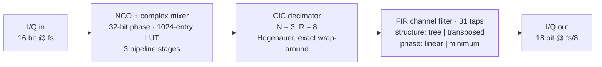
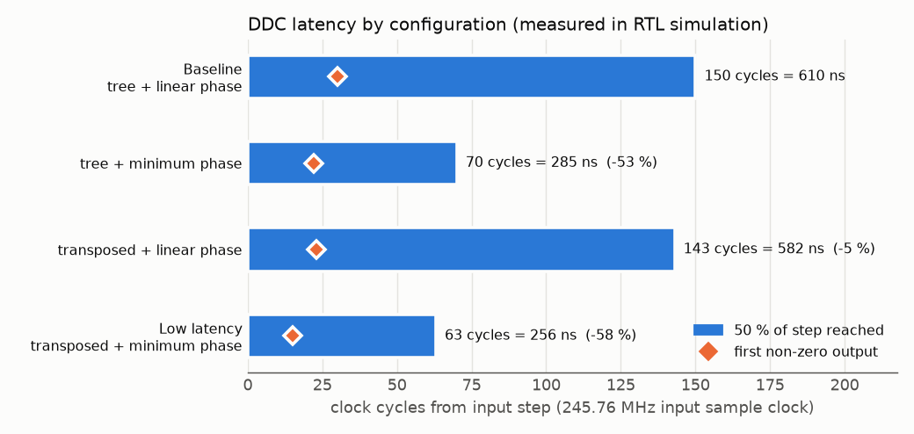
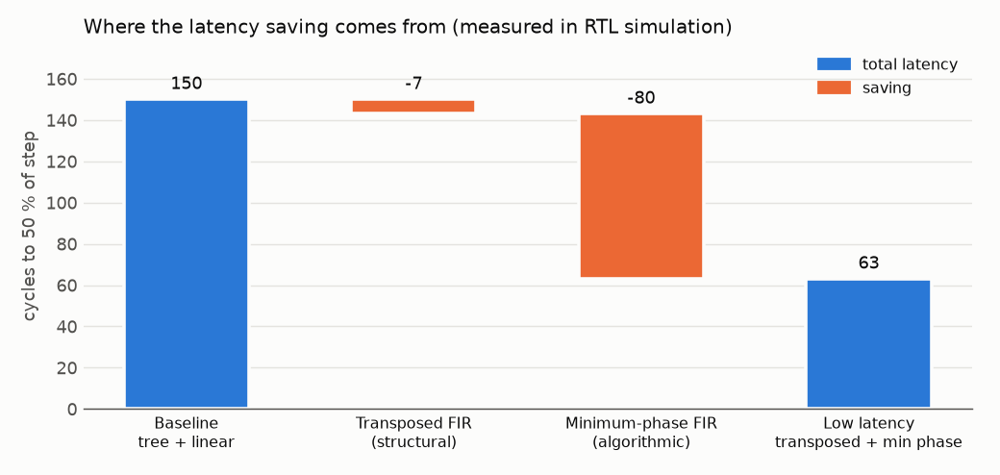
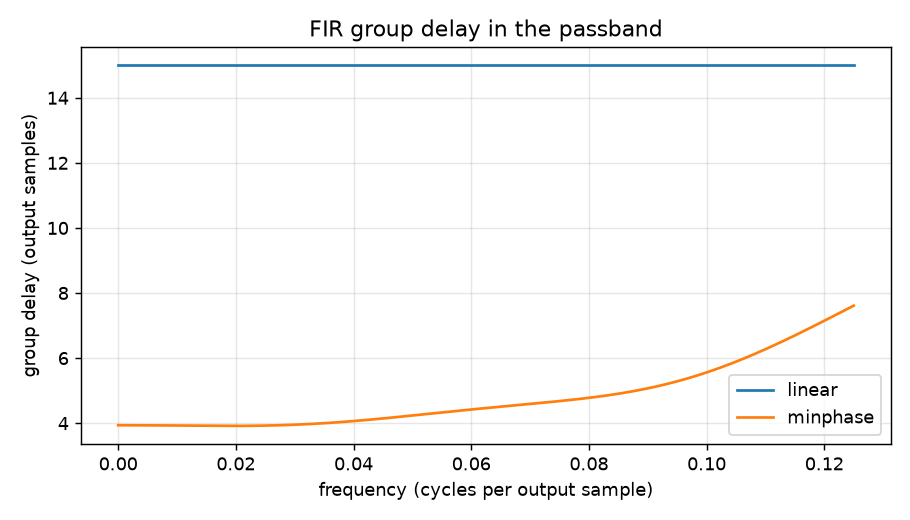
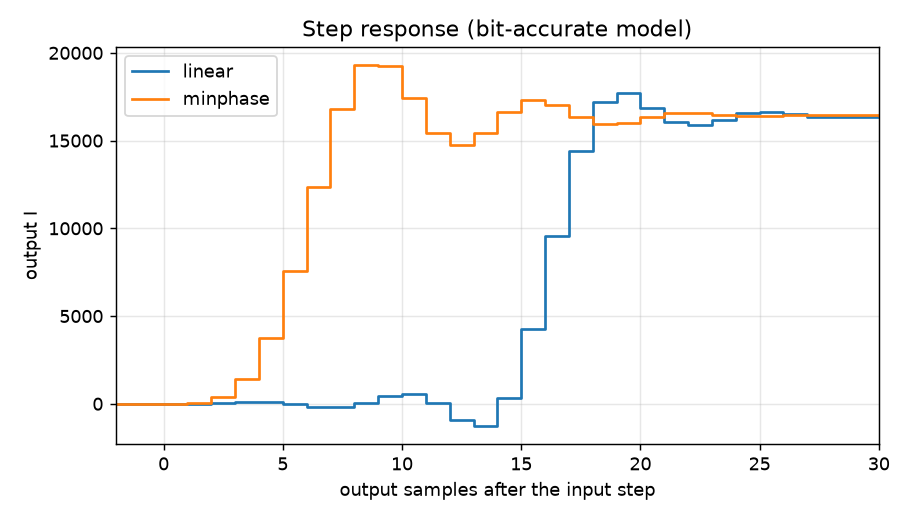
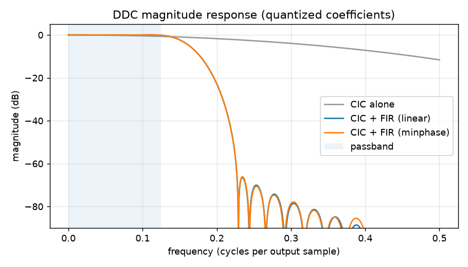

# Low-Latency SDR Digital Down-Converter in VHDL

A complete software-defined-radio receiver front-end, **NCO → complex mixer → CIC decimator →
FIR channel filter**, written in synthesizable VHDL, verified bit-exactly against a Python
fixed-point model, and built to answer one engineering question:

> **Where does latency come from in an FPGA DSP chain, and what actually reduces it?**


## Key results

| | Baseline | Low-latency design | Change |
|---|---:|---:|---:|
| Latency to 50 % of a step | 150 cycles · 610 ns | **63 cycles · 256 ns** | **−58 %** |
| FIR group delay (DC) | 15.0 output samples | 3.9 output samples | −74 % |
| Passband ripple (CIC + FIR) | 0.16 dB | 0.16 dB | unchanged |
| Stopband attenuation | 55 dB | 55 dB | unchanged |

Clock: 245.76 MHz input sample clock, decimation by 8 (30.72 MSPS output).

All latency figures are **measured in RTL simulation** (GHDL + VUnit). They also match, to the
clock cycle, an independent prediction from the bit-accurate model plus a count of the pipeline
registers. In other words, the hardware behaves exactly as designed, register by register.

---

## Contents

- [Architecture](#architecture)
- [Results and analysis](#results-and-analysis)
- [Design decisions and trade-offs](#design-decisions-and-trade-offs)
- [Verification](#verification)
- [Getting started](#getting-started)
- [Repository layout](#repository-layout)
- [Skills demonstrated](#skills-demonstrated)
- [Roadmap](#roadmap)

## Architecture



| Block | File | Notes |
|---|---|---|
| NCO + mixer | [`rtl/nco_mixer.vhd`](rtl/nco_mixer.vhd) | `y = x·e^(-jφ)`; Q1.15 sin/cos tables; four registered multipliers |
| CIC decimator | [`rtl/cic_decim.vhd`](rtl/cic_decim.vhd) | Integrators at input rate, combs on decimated samples; gain R^N = 2^9 removed by a shift (DC gain exactly 1) |
| FIR, adder tree | [`rtl/fir_tree.vhd`](rtl/fir_tree.vhd) | Delay line, products, 5 adder levels and output all registered: 8 cycles |
| FIR, transposed | [`rtl/fir_transposed.vhd`](rtl/fir_transposed.vhd) | Partial-sum chain; output 1 cycle after input, maps onto DSP48 multiply-add |
| Top level | [`rtl/ddc_top.vhd`](rtl/ddc_top.vhd) | Generics `G_TRANSPOSED` and `G_MINPHASE` select the variant |

All word widths, NCO tables and coefficients are defined once, in
[`model/design.py`](model/design.py), which generates
[`rtl/ddc_params_pkg.vhd`](rtl/ddc_params_pkg.vhd). The RTL and the model can't drift apart,
and CI fails if the committed package is out of date.

## Results and analysis

### 1. Latency by configuration



Each bar is the number of clock cycles, measured in RTL simulation, from the input step until
the output reaches 50 % of its final value. The diamond marks the first non-zero output.

- **The filter's phase decides the latency.** Switching only the coefficients from linear to
  minimum phase cuts latency from 150 to 70 cycles (−53 %), with the same structure and the
  same number of multipliers.
- **The FIR structure matters much less.** Switching only from adder tree to transposed form
  saves 7 cycles (−5 %): exactly the register stages it removes (from 8 down to 1).
- **The first response barely moves** (30 → 15 cycles). That metric is dominated by waiting for
  the first decimated sample, which doesn't tell you when the output becomes *useful*. That's
  why the 50 % point is the headline metric.

### 2. Where the saving comes from



The waterfall splits the 87-cycle saving into its two causes: **7 cycles structural** and
**80 cycles algorithmic**. The reason is decimation. After the CIC, one output sample lasts
8 clock cycles, so every sample of filter group delay costs 8 cycles, while a pipeline register
costs 1. Removing 11 samples of group delay is worth far more than removing 7 registers.

**Takeaway:** in a decimating chain, start latency work with the filter response, not with
retiming. This is also why the NCO/mixer keeps its 3 pipeline stages: they cost 3 cycles out of
63 and are what lets the design target ~250 MHz.

### 3. Group delay: the mechanism



- The **linear-phase** filter delays every frequency by exactly 15 output samples ((31 − 1)/2).
  Its constant group delay means no phase distortion, at the cost of placing the impulse
  response's centre in the middle of the filter.
- The **minimum-phase** filter concentrates its energy in the first taps: 3.9 samples of group
  delay at DC, rising to 7.6 at the passband edge. The design trades constant delay for low
  delay.
- **Cost:** a 3.7-sample spread in group delay across the passband is phase distortion.
  Narrowband channels, audio, control loops and detectors don't mind it. Wideband
  pulse-shape-sensitive uses (radar pulse compression, high-order QAM without an equalizer) may
  need linear phase. That's why both options stay available behind a generic.

### 4. Step response: what the output actually does



From the bit-accurate model, a DC step on I with the NCO at 0 Hz:

| | Linear phase | Minimum phase |
|---|---:|---:|
| 10 %–90 % rise | samples 15 → 18 | samples 4 → 7 |
| Overshoot | 7.7 % | 17.4 % |
| Settled within 2 % | 23 samples | 20 samples |

The minimum-phase output rises **about 11 output samples (~360 ns) earlier**, which is the
latency win. The honest caveat: it overshoots more and rings, so the time to settle within 2 %
improves only from 23 to 20 samples. If an application needs a fully settled value rather than
a fast response, the gain is smaller than the 50 % metric suggests.

### 5. Frequency response: the saving comes at no cost in selectivity



- The CIC alone droops by 0.66 dB at the passband edge and offers only 2.2 dB of attenuation at
  the stopband edge. On its own it can't select a channel.
- The FIR's passband is shaped as the inverse of that droop, so the **CIC + FIR cascade is flat
  to 0.16 dB**, and its stopband reaches **55 dB**.
- **Both curves overlap.** The minimum-phase filter has the same magnitude response as the
  linear-phase one by construction (see the next section), so the latency reduction costs
  nothing in selectivity, noise or interferer rejection. The plot uses the *quantized* Q1.17
  coefficients that are in the hardware.

## Design decisions and trade-offs

**Minimum-phase design without changing the magnitude** ([`model/design.py`](model/design.py)):
1. Design the 31-tap linear-phase filter `h` by weighted least squares, with the passband
   following 1/|H_CIC| to flatten the droop.
2. Convolve `h` with itself. `h * h` is still linear-phase, with magnitude |H|².
3. Homomorphic (cepstral) minimum-phase conversion halves the log-magnitude. That gives |H|
   back, with minimum phase and the same 31 taps.
4. Match the DC gain, then quantize to 18-bit Q1.17.

| Decision | Chosen | Alternative | Why |
|---|---|---|---|
| FIR structure | Transposed form | Pipelined adder tree | 1 cycle instead of 8, independent of tap count; each tap is one DSP48 multiply-add |
| FIR phase | Minimum phase (selectable) | Linear phase | 11 fewer samples (88 cycles) of delay, same magnitude; costs phase linearity |
| Data path | Sample-by-sample streaming, valid strobe | Block/FIFO-based | No buffering latency; a radio front-end can't be back-pressured anyway |
| CIC arithmetic | Wrap-around, no saturation | Saturating | Exact for a CIC with N·log₂R guard bits; fewer LUTs, no extra pipeline stages |
| NCO/mixer pipeline | Kept at 3 stages | Fewer registers | 3 cycles of 63; needed for Fmax |

The full write-up is in **[doc/latency.md](doc/latency.md)**.

## Verification

- **Bit-exact model.** [`model/ddc_model.py`](model/ddc_model.py) reproduces the RTL integer
  arithmetic exactly: floor shifts, two's-complement wrap-around, saturation, and even the CIC's
  register-level timing.
- **Self-checking testbench.** [`tb/tb_ddc.vhd`](tb/tb_ddc.vhd) (VUnit) runs two tests:
  - `bit_exact_tone`: a wanted tone, an out-of-band interferer and noise. Every I and Q output
    sample must equal the model.
  - `latency_step`: a DC step, also checked bit-exactly. Measures cycles to the first response
    and to 50 % of the final value.
- **Result:** 8 of 8 simulations pass. Every output sample of every configuration is identical
  to the model, and the measured latencies equal the predicted ones exactly.
- **Four configurations** (structure × phase) run per test, 8 simulations in total.
  [`run.py`](run.py) regenerates the vectors from the model first and writes
  [`doc/results.md`](doc/results.md) afterwards.
- **Continuous integration.** [`.github/workflows/sim.yml`](.github/workflows/sim.yml) runs
  everything with GHDL on every push and publishes the latency table in the job summary.

## Getting started

Requirements: Python ≥ 3.10 and [GHDL](https://github.com/ghdl/ghdl). Vivado is optional, for
resource and timing reports only.

```bash
sudo apt install ghdl      # Ubuntu / Debian
make venv                  # Python environment: numpy, scipy, matplotlib, VUnit
make sim                   # 8 RTL simulations, bit-exact checks, doc/results.md
make analyze               # all figures in doc/images/ + filter summary
make synth T=1 M=1         # Vivado out-of-context build of one configuration
```

## Repository layout

```
├── model/
│   ├── design.py        parameters, filter design, VHDL package generator
│   ├── ddc_model.py     bit-accurate model and test-vector generator
│   ├── analyze.py       filter figures (magnitude, group delay, step response)
│   └── plot_results.py  latency figures (by configuration, waterfall)
├── rtl/                 synthesizable VHDL (ddc_params_pkg.vhd is generated)
├── tb/                  VUnit testbench
├── syn/                 Vivado non-project Tcl flow and constraints
├── doc/
│   ├── latency.md       design notes on latency
│   ├── results.md       measured latency table (generated by run.py)
│   └── images/          figures used in this README
├── run.py               VUnit runner
└── Makefile
```

## Skills demonstrated

| Area | Evidence |
|---|---|
| Synthesizable VHDL | Array-typed generics, generate statements, fixed-point `numeric_std` arithmetic |
| DSP for FPGA | NCO, complex mixing, CIC decimation, droop compensation, FIR architectures |
| Filter design | Weighted least-squares FIR, minimum-phase conversion, quantization analysis |
| Latency engineering | Structural vs. algorithmic latency, quantified per technique |
| Verification | Bit-exact golden model, self-checking VUnit testbench, cycle-accurate measurement |
| Tooling | Python-generated VHDL, Makefile flow, GitHub Actions CI, Vivado Tcl |

## Roadmap

- [x] RTL-measured latency, matching the model-based prediction cycle for cycle
- [ ] Vivado utilization and timing for all four configurations on a Zynq-7010
- [ ] AXI-Lite register interface (phase increment, coefficient bank) and AXI-Stream wrapper
- [ ] Half-band and polyphase decimation stages
- [ ] Hardware run on an ADALM-PLUTO (Zynq-7010 + AD9363), with latency captured on an ILA
